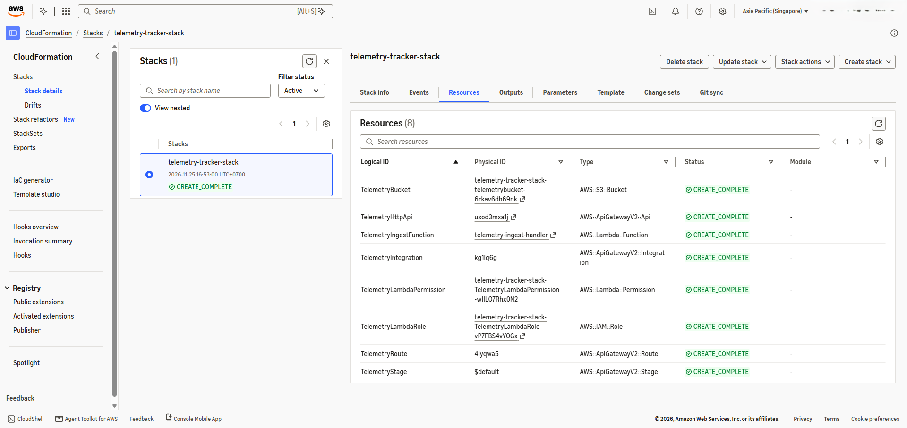
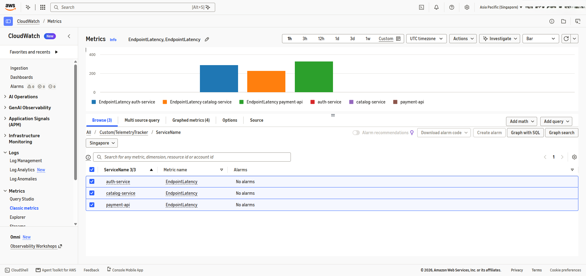
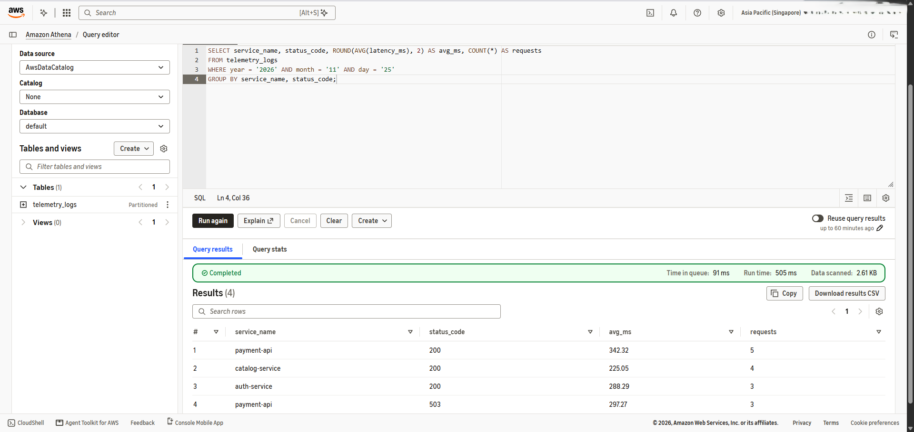

# Serverless Telemetry & Observability Mini-Tracker

Sistem pemantauan performa *endpoint* dan analitik log berbasis *serverless* di Amazon Web Services (AWS) yang dirancang menggunakan pendekatan **Infrastructure as Code (IaC)** dengan biaya operasional minimalis (*pay-as-you-go*).

Proyek ini dibangun untuk menerapkan konsep fundamental *Serverless*, *Storage*, *Data Analytics*, serta *Management & Governance* ke dalam skenario pemantauan aplikasi yang siap pakai.

---

## Nilai Bisnis (*Business Value*)

* **Deteksi Dini Gangguan Layanan:** Mengumpulkan metrik latensi dan kode status HTTP secara *real-time* sehingga penurunan performa atau *error* (seperti `503 Service Unavailable`) dapat teridentifikasi sebelum berdampak luas ke pengguna.
* **Efisiensi Biaya Operasional (OPEX):** Menghilangkan kebutuhan server pemantau yang menyala 24/7. Seluruh pemrosesan berjalan berbasis *event* dan menggunakan *Partition Projection* pada Amazon Athena tanpa memerlukan *AWS Glue Crawler*.
* **Replikasi & Kebersihan Lingkungan (*IaC Hygiene*):** Seluruh infrastruktur didefinisikan dalam satu *template* AWS CloudFormation sehingga dapat di-*deploy* ulang maupun dihapus total dalam hitungan menit.

---

## Arsitektur Sistem

```text
[Client / simulate.py]
         │
         ▼  POST /telemetry (JSON Payload)
[Amazon API Gateway (HTTP API)]
         │
         ▼  Invoke
[AWS Lambda (Python 3.12)]
   ├──► [Amazon CloudWatch Logs]     ──► Analisis via Logs Insights
   ├──► [Amazon CloudWatch Metrics]  ──► Grafik EndpointLatency (Custom Namespace)
   └──► [Amazon S3 (Partitioned)]    ──► Kueri SQL via Amazon Athena (Partition Projection)
```
## Dokumentasi Visual

### 1. AWS CloudFormation (`CREATE_COMPLETE` pada seluruh 8 resource)


### 2. Amazon CloudWatch Custom Metrics (`EndpointLatency` per layanan)


### 3. Amazon Athena Query Editor (Agregasi & Partition Projection)

